<h1 align="center">GameLauncherTV</h1>

<p align="center">
  <b>Seu celular com cara de console.</b><br>
  Tela inicial para Android no estilo do Android TV, feita para jogar com controle:<br>
  jogos, emuladores, filmes e trailers num só lugar.
</p>

<p align="center">
  <a href="https://github.com/Breno12276/GameLauncherTV/releases/latest"><b>⬇ Baixar o APK</b></a> ·
  <a href="https://breno12276.github.io/GameLauncherTV/">Site</a> ·
  <a href="#-recursos">Recursos</a> ·
  <a href="#-temas-de-console">Temas</a> ·
  <a href="#-menu-rápido-por-cima-do-jogo">Menu rápido</a> ·
  <a href="#-plataformas">Plataformas</a> ·
  <a href="#-como-instalar">Como instalar</a>
</p>

<p align="center">
  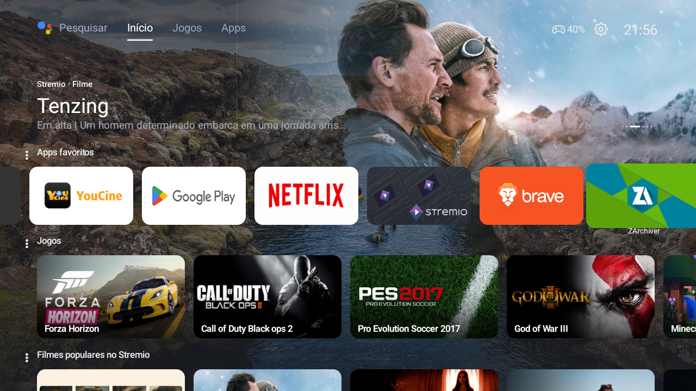
</p>

<p align="center">
  Android 13+ · APK de ~770 KB · 7 temas de console · sem anúncios · sem cadastro · funciona sem chave de API
</p>

---

## ✨ Recursos

<table>
  <tr>
    <td width="50%">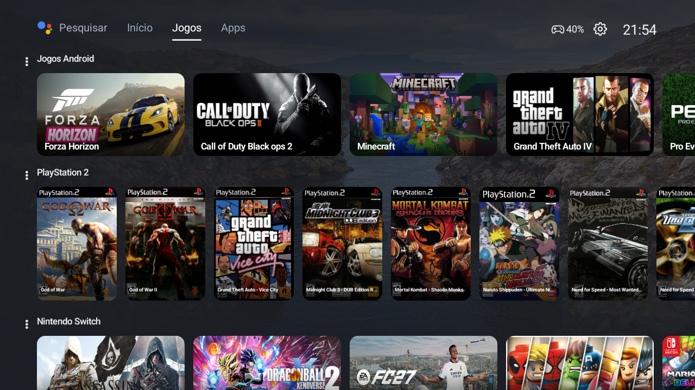</td>
    <td width="50%">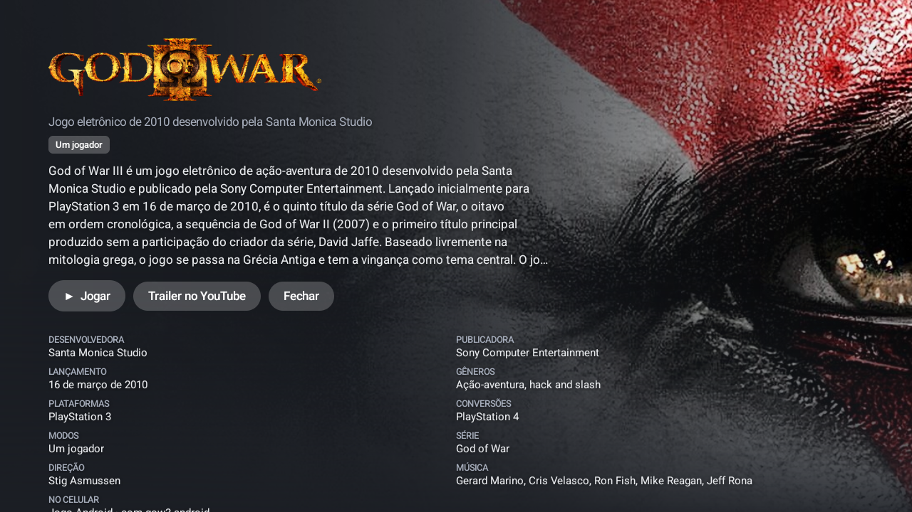</td>
  </tr>
  <tr>
    <td><b>🎮 Todos os jogos num lugar</b><br>Jogos de Android e ROMs de 18 plataformas, cada uma na sua fileira, com capa automática. Cada jogo abre direto no emulador certo.</td>
    <td><b>📖 Página de cada jogo</b><br>Sinopse em português, ficha técnica, selos, galeria de prints, trailer e conquistas do RetroAchievements.</td>
  </tr>
  <tr>
    <td>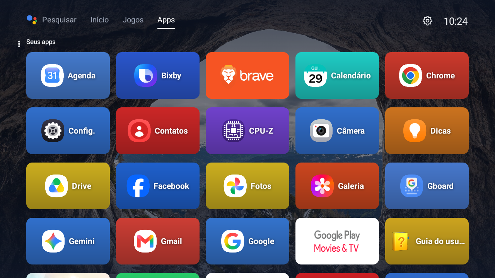</td>
    <td>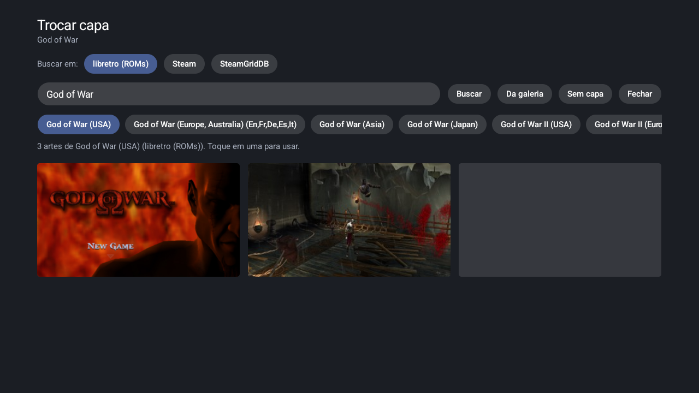</td>
  </tr>
  <tr>
    <td><b>🧩 Apps em cores</b><br>Cada app num card na cor do próprio ícone, ou com o banner de Android TV que ele traz.</td>
    <td><b>🖼️ Trocar capa</b><br>Busque artes no libretro, GameTDB, Steam, App Store, Internet Archive ou SteamGridDB, ou use uma foto sua.</td>
  </tr>
  <tr>
    <td>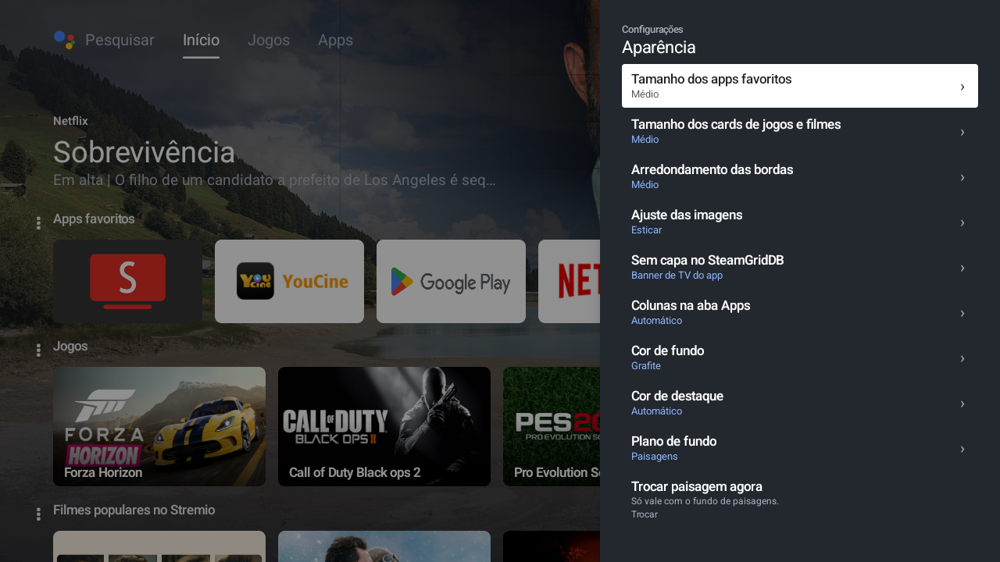</td>
    <td>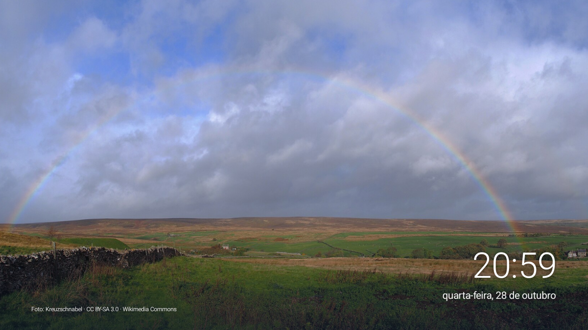</td>
  </tr>
  <tr>
    <td><b>🎨 Do seu jeito</b><br>Tamanho e cantos dos cards, cores de fundo e de destaque (ou automáticas pelo tema do Android), ordem das fileiras.</td>
    <td><b>🏔️ Fundos e descanso de tela</b><br>Paisagens premiadas do Wikimedia Commons, com crédito, e relógio no descanso de tela.</td>
  </tr>
</table>

## 🎮 Temas de console

Em **Configurações → Temas e sons → Tela inicial**, o app inteiro muda de cara: tela inicial, biblioteca, todos os apps, busca, configurações, opções e informações do jogo, janelas e o menu rápido. Tudo é desenhado pelo app, imitando só a organização de cada console, sem logos, ícones, sons ou fontes das fabricantes.

<table>
  <tr>
    <td width="50%">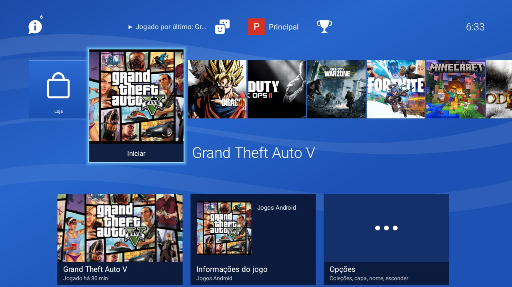</td>
    <td width="50%">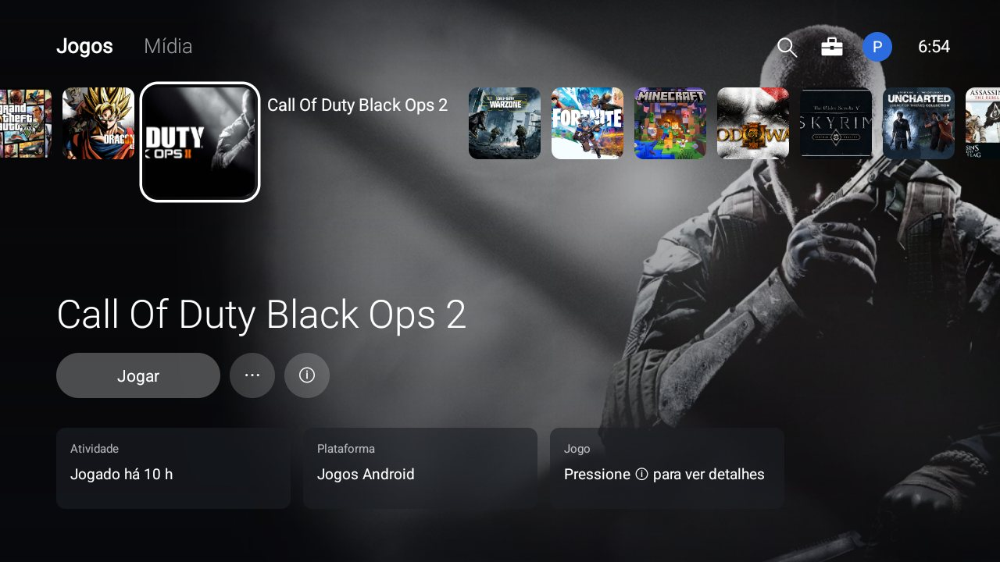</td>
  </tr>
  <tr>
    <td><b>Estilo PS4</b>: fileira de blocos, biblioteca com categorias, fundo azul com ondas.</td>
    <td><b>Estilo PS5</b>: abas Jogos e Mídia, arte do jogo na tela toda, botão Jogar.</td>
  </tr>
  <tr>
    <td>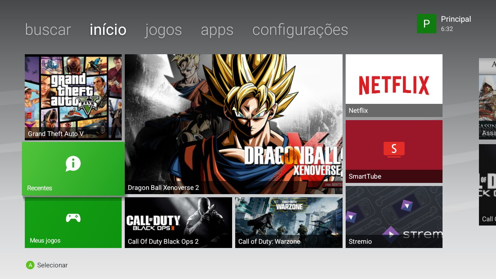</td>
    <td>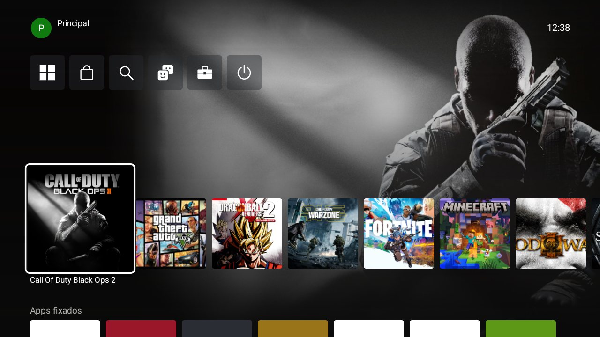</td>
  </tr>
  <tr>
    <td><b>Estilo Xbox 360</b>: categorias e blocos verdes.</td>
    <td><b>Estilo Xbox Series</b>: acesso rápido, jogados recentemente e apps fixados.</td>
  </tr>
  <tr>
    <td>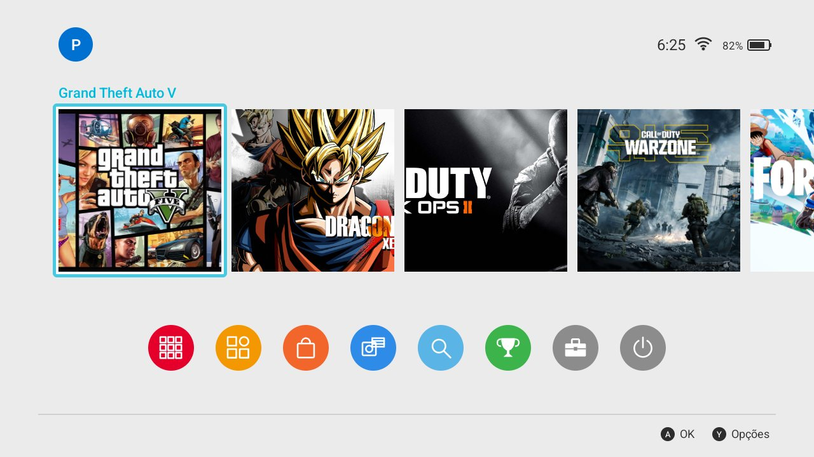</td>
    <td>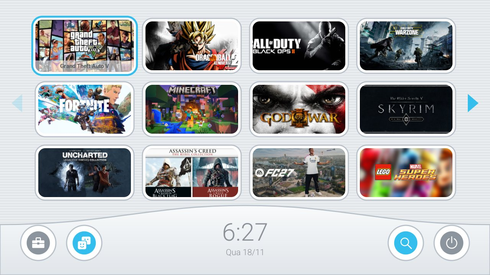</td>
  </tr>
  <tr>
    <td><b>Estilo Switch</b>: quadrados grandes e botões redondos coloridos.</td>
    <td><b>Estilo Wii</b>: canais em grade e relógio na faixa de baixo.</td>
  </tr>
</table>

As capas acompanham o tema: **quadradas** no PS4, PS5, Switch e Xbox Series, **banners** no Android TV, Xbox 360 e Wii. Ao trocar de tema, as que faltam são buscadas sozinhas.

## ☰ Opções de cada jogo

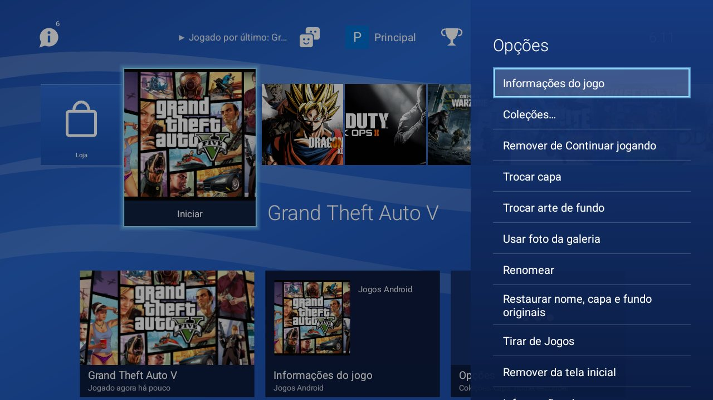

Segure **△ / Y** num jogo: informações, coleções, trocar capa (deitada, em pé ou quadrada) ou arte de fundo, foto da galeria, renomear, restaurar o original, emulador e plataforma da ROM, abrir com outro app, detalhes do arquivo, esconder ou marcar como “só para adultos”.

## ⏏️ Menu rápido por cima do jogo

Com um jogo aberto, **segure o botão PS** e um menu aparece por cima dele, como no console. No topo: o jogo, a bateria do controle e do celular, a hora, a temperatura e a memória. Funciona sem root, pelo serviço de acessibilidade (ligado uma vez); com root, ganha mais opções.

| Página | O que tem |
|---|---|
| Jogo | Voltar ao jogo, ir para o início, fechar o jogo, capturar ou gravar a tela, modo mouse, Dormir |
| Tela e som | Brilho, brilho automático, 120 Hz, desligar a tela, sem som, Não perturbe |
| Controle | Luz do controle e brilho dela, testar vibração, vibrar ao abrir um jogo |
| Desempenho | Liberar memória, modo desempenho fixo ou ao abrir jogos (root) |
| Rede e energia | Wi-Fi, modo avião, Bluetooth, limite da carga (root), reiniciar ou desligar |

E também:

- 🎬 **Trailers automáticos:** pare o foco num jogo ou filme e o trailer toca no fundo; sem mexer no controle, ele vai para tela cheia.
- 🍿 **Filmes e séries em alta:** fileiras do Stremio, Apple, Netflix (via TMDB) e YouTube, com títulos em português.
- 🌈 **Luz e vibração do controle:** a barra de luz do DualShock 4 / DualSense acompanha a cor do jogo em foco.
- 📱 **Chaves pelo celular:** escaneie um QR code e cole as chaves no celular, sem digitar com o controle.
- 🗂️ **Fonte das capas:** em **Configurações → Capas**, escolha de onde baixar as capas de todos os jogos e, se quiser, uma fonte para cada plataforma (ex.: tudo da Steam, Switch do SteamGridDB). Com "Só da fonte escolhida", as capas vêm apenas dela.
- 👥 **Perfis e controle parental:** favoritos, coleções, aparência e contas por pessoa; perfis infantis com PIN, limite de tempo por dia e sem jogos “só para adultos”.
- 📚 **Coleções:** fileiras suas ("Multiplayer", "Zerar"…) com jogos de qualquer plataforma.
- 📊 **Estatísticas:** tempo jogado hoje, na semana e no total, gráfico dos dias e os jogos mais jogados.
- ☁️ **Jogos na nuvem:** catálogos do GeForce NOW e do Xbox Cloud Gaming, sem chave.
- 🟩 **Contas Xbox e Steam:** gamerscore e conquistas pelo OpenXBL; sua biblioteca da Steam e o que dela roda no GeForce NOW.
- 🖱️ **Modo mouse:** cursor pelo controle e botões mapeados em apps que não aceitam controle.
- 💾 **Backup:** configurações, capas, histórico e perfis num arquivo; com root, também os saves dos emuladores.
- ⚙️ **Recursos com root:** limite de carga, modo desempenho, atualizar emuladores pelas releases oficiais. Resolução e densidade também sem root, com uma permissão dada pelo PC.
- 🌙 **Dormir:** pausa, liga a economia de energia e apaga a tela (a TV entra em espera).
- 🔊 **Sons de navegação** gerados pelo próprio app, e **clima e temperatura** embaixo do relógio.

## 🕹️ Plataformas

O GameLauncherTV não emula nada: ele encontra suas ROMs e abre cada uma no emulador que você já tem.

| Plataforma | Emuladores reconhecidos |
|---|---|
| PlayStation · PS2 · PS3 · PS4 | DuckStation, NetherSX2/AetherSX2, aPS3e/RPCS3, shadPS4 |
| PSP · PS Vita | PPSSPP, Vita3K |
| Switch · Wii U · GameCube/Wii | Eden, Yuzu, Sudachi, Citron, Cemu, Dolphin |
| 3DS · DS | Azahar, Lime3DS, Citra, melonDS, DraStic |
| N64 · GBA · GB · SNES · NES · Mega Drive | RetroArch |
| Dreamcast · Xbox 360 | Flycast, Redream, aX360e |

Qualquer outro emulador pode ser escolhido em **Configurações → Emuladores → Outro app instalado…**

## 🎮 Controle

| Botão | Ação |
|---|---|
| R1 / L1 | Próxima aba / aba anterior |
| R2 / L2 | Pula vários cards |
| Start | Configurações |
| Select | Pesquisar |
| □ / X | Informações do jogo |
| △ / Y | Opções do card (renomear, capa, mover, esconder) |
| PS (segurar) | Menu rápido por cima do jogo |
| PS | Volta para a tela inicial |
| PS + Share | Fecha o jogo aberto |

## 🔑 Chaves de API (opcionais)

Sem nenhuma chave, o app usa só fontes livres: Steam, Wikipédia, libretro, GameTDB, Stremio, Apple e Wikimedia Commons. As chaves abaixo são grátis e completam o resto. Coloque-as em **Configurações → Contas e chaves**.

| Serviço | O que acrescenta |
|---|---|
| TMDB | Filmes e séries em português, fileiras da Netflix, trailers dublados |
| SteamGridDB | Capas, logos e artes que as fontes livres não têm |
| YouTube | Trailers de jogos fora da Steam e "Em alta no YouTube" |
| RetroAchievements | Suas conquistas nas ROMs |

As chaves ficam só no seu aparelho. O APK público não traz nenhuma chave.

## 📲 Como instalar

1. Baixe o `GameLauncherTV-X.Y-publico.apk` na [última versão](https://github.com/Breno12276/GameLauncherTV/releases/latest).
2. Instale, permitindo "instalar apps desconhecidos".
3. Abra pela gaveta de apps para experimentar.
4. Para virar a tela inicial: **Configurações → Sistema → Tela inicial padrão do celular** → GameLauncherTV.

## 🛠️ Compilar

Projeto Android em Kotlin (minSdk 33, compileSdk 36, Java 17).

```bash
./gradlew assemblePublicoRelease
```

A variante `pessoal` lê `TMDB_KEY`, `STEAMGRIDDB_KEY` e `YOUTUBE_KEY` de um `segredos.properties` na raiz, que fica fora do Git.

---

<sub>Projeto pessoal, sem relação com Google, Sony, Nintendo, Valve ou os serviços citados; as marcas e artes pertencem aos seus titulares. Este produto usa a API do TMDB, mas não é endossado nem certificado pelo TMDB. Paisagens: Wikimedia Commons (CC BY-SA).</sub>
